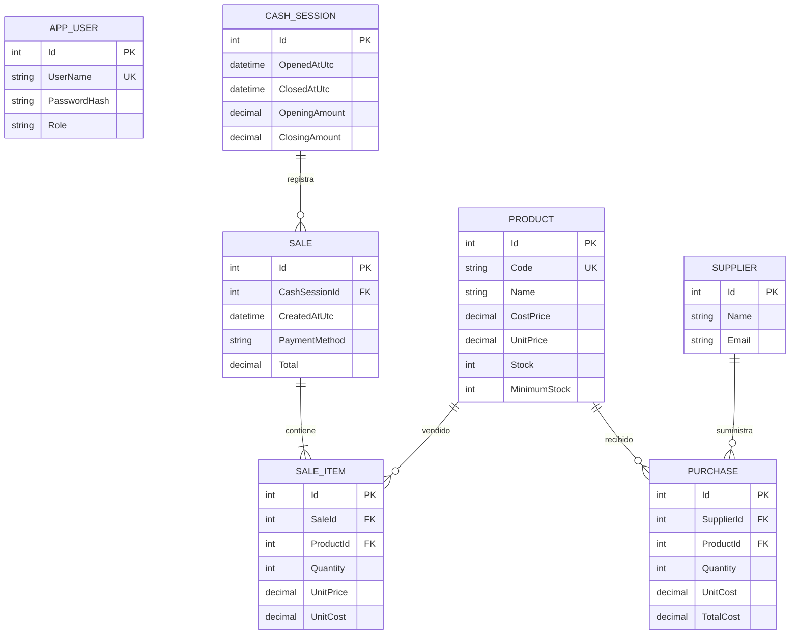

# Diagrama del modelo de datos

Este diagrama resume las relaciones configuradas en `AppDbContext`. Los campos entre paréntesis indican referencias; no es un esquema de migraciones.

Consulta la explicación de [entidades y restricciones](../modelo-de-datos.md).
