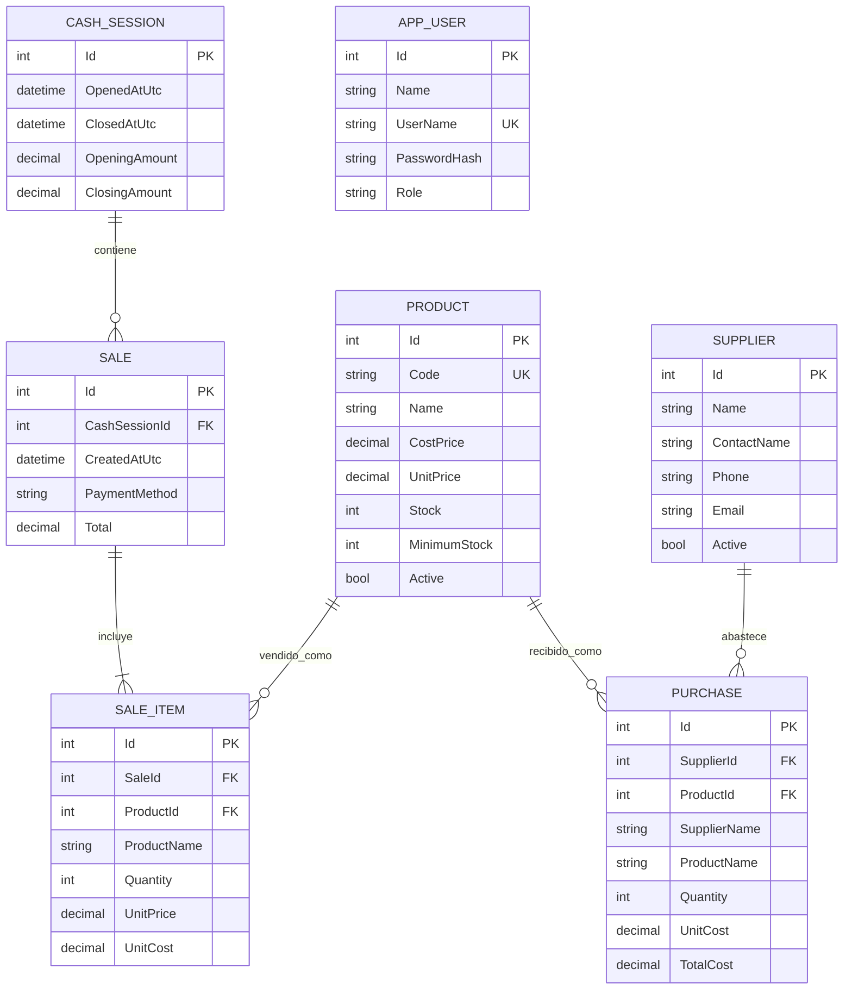

# Modelo de datos

El esquema vigente está definido por las entidades de `src/Stoxx.Web/Data/Entities.cs` y la configuración de `AppDbContext.cs`. La aplicación crea el esquema con EF Core `EnsureCreated`.

## Entidades y relaciones

- **AppUser:** credenciales, nombre y rol. El nombre de usuario tiene índice único; la contraseña se guarda como hash.
- **Product:** código único, categoría, precios, stock, mínimo y estado activo.
- **Supplier:** datos de contacto y estado activo.
- **CashSession:** apertura, cierre, montos y responsables de caja.
- **Sale:** fecha, método de pago, total, cajero y sesión de caja.
- **SaleItem:** producto y cantidad vendidos, con nombre, costo y precio copiados para conservar el detalle histórico.
- **Purchase:** proveedor, producto, cantidades y costos; conserva sus nombres como instantánea del momento de registro.

Cada venta pertenece a una sesión de caja y tiene partidas. Cada partida referencia un producto. Cada compra referencia un proveedor y un producto. Los registros de venta y compra retienen nombres y precios/costos históricos aunque cambien los datos actuales del catálogo.

## Reglas de persistencia observables

- Los códigos de producto y nombres de usuario son únicos.
- Los campos monetarios se configuran con precisión de 12 dígitos y 2 decimales.
- No se permite eliminar físicamente productos ni proveedores desde la API; se marcan inactivos.
- Las relaciones de partidas de venta, compras y sesiones de caja usan borrado restringido para proteger el historial.
- No hay relación de clave foránea entre `AppUser` y ventas/compras; el responsable se conserva como texto.
